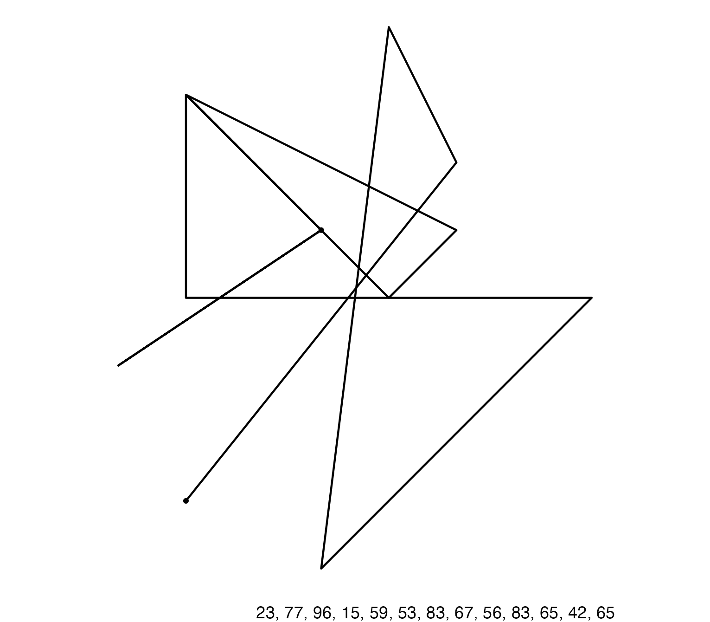

<!-- badges: start -->

<!-- badges: end -->

# bestiary

Welcome to the bestiary, where wee beasties roam free. Like the game where you stare at the clouds and try to see shapes, but on a computer and without clouds. 

This one, for instance, looks like a bird that's fallen over.  

```{r echo=FALSE, out.width='30%'}

```

If you find a beastie you like, you can also adopt it. 


